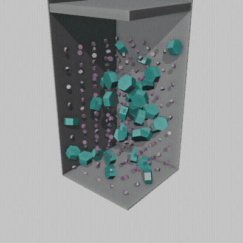

# Packing animation

This example simulates a small packing of 200 hexagonal prisms of two types and renders
it as an animated GIF: the particles fall into the container, and then the piston
compacts them.



## Requirements

- Blender. The animation was rendered with Blender 4.3.2.
- [`ffmpeg`](https://ffmpeg.org/) on your `PATH`, which turns the rendered frames into a GIF.

## Steps

Run these from this directory.

1. Simulate the packing. `animation.json` sets `save_blender_file`, so the baked
   simulation is saved to `packing_animation.blend`:

    ```shell
    packgen -- animation.json
    ```

    This opens the Blender window and closes it when done. To run without a window,
    call Blender directly (on Linux, replace `Blender` by `blender`):

    ```shell
    Blender -b -P "$(python -c 'import packgen; print(packgen.BLENDER_SCRIPT)')" -- animation.json
    ```

2. Render the animation to a GIF:

    ```shell
    Blender -b packing_animation.blend -P render_animation.py -- packing.gif
    ```

    Rendering 120 frames with the Workbench engine takes about 15 seconds. Run
    `render_animation.py` with `--size`, `--step`, `--fps` and `--hold` to change the
    size, frame skipping, speed and the pause before looping. See the script's docstring
    for details.

The container walls facing the camera are cut away, and the piston is drawn as a thin
plate, so that the particles stay visible. This only affects the rendering; the
simulated motion is unchanged.

The GIF in the docs (`docs/assets/packing.gif`) is produced with exactly these commands,
and then copied:

```shell
cp packing.gif ../../docs/assets/packing.gif
```
